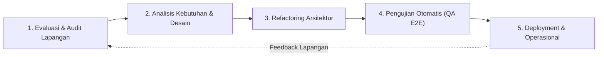
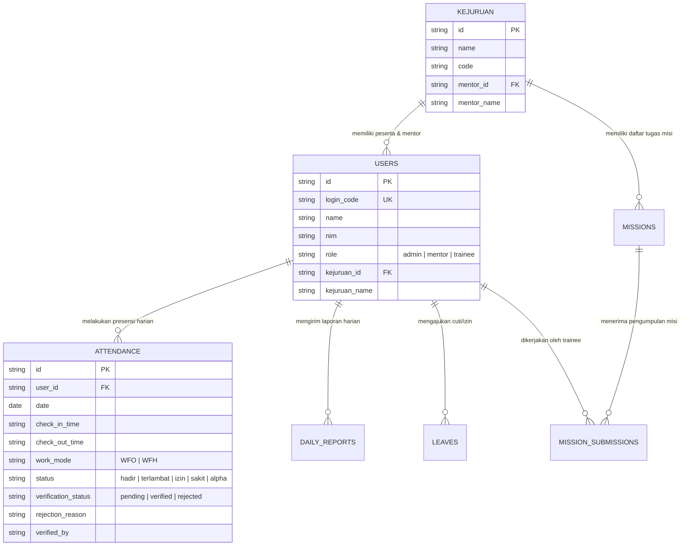

# 01. Siklus SDLC & Arsitektur Sistem

## 1. Tahapan SDLC yang Diterapkan

Pengembangan sistem Presensi PSA menerapkan metode **Agile-Iterative SDLC** yang berfokus pada adopsi pengguna nyata di tempat magang. Tahapannya mencakup:

1. **Fase 1: Evaluasi & Audit Lapangan**:
   - Menganalisis alur kerja aktual tempat magang: jam masuk peserta, pola WFH/WFO, kebiasaan mentor, dan format rekap yang dibutuhkan pimpinan.
   - Mengidentifikasi hambatan UX dan penyebab aplikasi jarang digunakan secara konsisten.
2. **Fase 2: Analisis Kebutuhan & Desain Arsitektur**:
   - Mendesain batasan peran (Role Boundaries): *Trainee*, *Mentor*, dan *Admin*.
   - Menghilangkan friksi alur WFH dengan pendekatan *Optimistic Submission*.
3. **Fase 3: Implementasi & Refactoring Kode**:
   - Pembersihan *hardcode* nama mentor menjadi relasi dinamis berbasis data kejuruan.
   - Restrukturisasi hook React dan manajemen state (`AppContext`).
   - Normalisasi endpoint REST API Express.js.
4. **Fase 4: Verifikasi & Jaminan Kualitas (QA)**:
   - Penulisan skrip pengujian otomatis komprehensif (`scripts/test-e2e.ts`) yang mencakup 39 skenario pengujian fungsional, *boundary*, dan sekuriti.
5. **Fase 5: Kesiapan Rilis & Operasional**:
   - Persiapan migrasi database otomatis saat server pertama kali dijalankan.
   - Fasilitas export rekap Excel/PDF untuk pelaporan mingguan/bulanan.

---

## 2. Arsitektur Teknologi

### Stack Teknologi

- **Frontend**:
  - **Framework**: React 18 dengan TypeScript.
  - **Build Tool**: Vite (bundling cepat, hot module replacement).
  - **Styling**: Tailwind CSS dengan skema warna korporat (Navy/Deep Cyan `#123B59`, Slate Blue `#4C83B5`, Soft Amber, dan Rose).
  - **Icons**: Lucide React.
  - **Ekspor Dokumen**: `xlsx` (Excel) dan `jspdf` / `html2canvas` (PDF).

- **Backend**:
  - **Runtime**: Node.js dengan Express.js.
  - **Bahasa**: TypeScript (`tsx`).
  - **Database Driver**: `mysql2/promise` dengan *connection pooling*.
  - **Autentikasi**: JSON Web Token (JWT) + *bcryptjs* hashing kata sandi.

- **Database**:
  - MySQL / TiDB dengan skema InnoDB UTF-8.

---

## 3. Desain Data Model & Relasi Entitas

Hubungan data utama dalam aplikasi dirancang dengan integritas relasional:

### Karakteristik Relasi:
- **Dinamis Multi-Program**: Seorang mentor dapat ditugaskan ke satu atau beberapa program kejuruan melalui tabel `kejuruan.mentor_id`.
- **Integritas Role**: Kolom `role` diproteksi ketat sehingga peserta magang (`trainee`) tidak dapat mengakses maupun memanipulasi presensi peserta lain atau presensi mentor.

